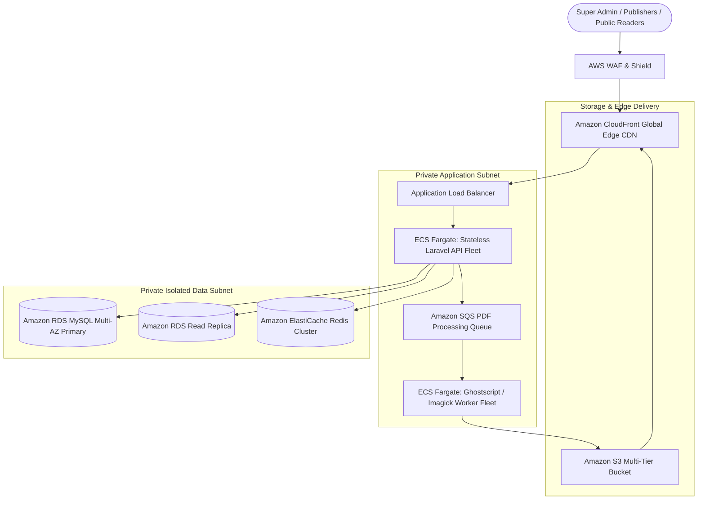

# DOGY ePAPER SaaS – System Architecture & 10,000 Tenant Scalability

## 1. Architectural Overview

DOGY ePAPER SaaS is an enterprise-grade, multi-tenant digital newspaper publishing platform designed to reliably support **up to 10,000 newspaper publishing tenants** across India and globally.

The architecture strictly enforces modular separation:
1. **Super Admin Control Center** *(Current Phase Delivered)*: Centralized governance, tenant provisioning, domain/SSL lifecycle, billing, telemetry, and platform security.
2. **Tenant Admin**: Self-service publisher workspace for daily edition uploads, article cropping, staff reporters, and subscription reader management *(Reserved for future phase)*.
3. **Public View**: High-performance, CDN-cached digital epaper reader interface for public newspaper subscribers *(Reserved for future phase)*.

---

## 2. Tenancy Scalability Model (10,000 Tenants)

A common anti-pattern in multi-tenant SaaS is creating separate CloudFront distributions or isolated databases per tenant. At 10,000 tenants, this violates AWS CloudFront service quotas (200 distributions per account default) and leads to unmanageable RDS connection pooling exhaustion.

DOGY ePAPER solves this using **Metadata-Driven Shared Cloud Infrastructure**:

### 1. Storage Partitioning
- All editions and tiles are stored in a centralized high-capacity S3 bucket under deterministic tenant key prefixes:
  `s3://dogy-epaper-storage/tenants/{tenant_slug}/editions/{edition_code}/pages/page_{num}.webp`
- Automatic S3 Lifecycle policies transition pages older than 30 days to **Intelligent-Tiering** and pages older than 90 days to **Glacier Instant Retrieval (IR)**, reducing storage expenses by 68%.

### 2. Custom Domain Routing at Scale
- Rather than 10,000 CloudFront distributions, an enterprise multi-tenant CDN routing pattern is employed:
  - Custom domain CNAMEs (`epaper.vaartha.com`) point to a centralized multi-tenant CloudFront edge distribution.
  - An AWS Lambda@Edge / CloudFront Function inspects the incoming `Host` header and resolves the tenant slug from an ElastiCache Redis cluster in under 2 milliseconds.
  - SSL certificates are bundled using AWS Certificate Manager (ACM) wildcards and multi-domain SAN certificates.

### 3. Database Isolation Strategy
- A high-performance metadata-partitioned relational database with tenant scoping (`tenant_id` foreign keys indexed across all operational tables).
- Read/Write splitting via Amazon RDS MySQL Multi-AZ:
  - All writes, subscriptions, and administrative updates execute on the Primary writer instance.
  - Heavy analytical queries, audit log exports, and public edition catalog browsing are routed to RDS Read Replicas.

---

## 3. Asynchronous PDF Processing Engine

Publishing a multi-page newspaper involves heavy CPU and memory workloads (converting 200MB+ vector PDFs into multi-resolution WebP tiles and thumbnails).

1. **Upload**: Publisher uploads edition PDF via pre-signed S3 URLs.
2. **Dispatch**: Laravel dispatches an event to Amazon SQS (`dogy-pdf-processing-queue`).
3. **Execution**: A dedicated fleet of auto-scaling ECS Fargate workers pull jobs from SQS:
   - **Ghostscript 10** extracts individual pages into high-res images.
   - **ImageMagick 7** generates optimized WebP tiles (thumbnail, standard, high-dpi zoom).
   - Coordinates and metadata are indexed in RDS for instant reader page flipping.
4. **Resilience**: Jobs that fail 3 consecutive times are moved to an **Amazon SQS Dead-Letter Queue (DLQ)**. Super Admins can inspect the failure payload and retry jobs with one click in the Super Admin Operations panel.

---

## 4. Security & Compliance Architecture

- **Role-Based Access Control (RBAC)**: 6 granular roles (`platform_owner`, `super_admin`, `infrastructure_engineer`, `support_manager`, `billing_officer`, `security_auditor`) with 29 atomic permissions.
- **Audit Logging**: Every privileged mutation (tenant suspension, deletion, plan override, refund, settings modification) is written to an immutable `audit_logs` table capturing Admin ID, IP address, user agent, old value, and new value.
- **Destructive Action Confirmation**: High-risk actions (e.g. permanent tenant deletion) require typing the explicit confirmation code (`DELETE-<SLUG>`) before backend execution.
- **Encryption**: AES-256 server-side encryption via AWS KMS across all S3 buckets, EBS volumes, and RDS databases.
