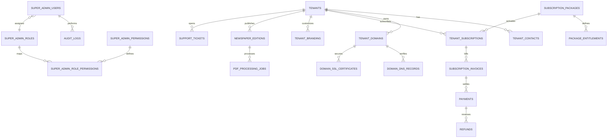

# DOGY ePAPER SaaS – Database Schema & Data Tenancy Model

## 1. Tenancy Model Overview

DOGY ePAPER SaaS utilizes a high-efficiency **Shared Schema with Row-Level Tenant Scoping and Composite Indexing**. This pattern delivers optimal operational economics and linear performance scaling up to 10,000 tenants without requiring thousands of isolated database schemas.

### Primary Design Rules:
1. **Tenant ID Scoping**: Every operational and customer entity (`editions`, `invoices`, `domains`, `branding`, `tickets`) maintains a non-nullable `tenant_id` foreign key.
2. **Composite Indexing**: Every high-volume table contains composite indexes beginning with `tenant_id` (e.g. `INDEX (tenant_id, status)`, `INDEX (tenant_id, created_at)`).
3. **Database Transactions**: All multi-step workflows (tenant registration wizard, plan switching, invoice generation) execute within atomic database transactions with rollback protection.
4. **Referential Integrity**: Cascading deletes are strictly disabled on financial records (`payments`, `invoices`, `refunds`, `audit_logs`).

---

## 2. Entity Relationship Overview

---

## 3. Core Enterprise Tables

### 1. `super_admin_users`
- Stores administrative staff credentials, 2FA status, role mappings, and login metadata.
- Columns: `id`, `name`, `email`, `password`, `phone`, `role_id`, `status`, `two_factor_enabled`, `two_factor_secret`, `last_login_at`, `last_login_ip`.

### 2. `tenants`
- Central publisher registry.
- Columns: `id`, `newspaper_name`, `company_name`, `tenant_slug`, `storage_prefix`, `default_language`, `timezone`, `status` (`pending`, `active`, `suspended`, `expired`, `archived`), `metadata`, `created_at`.

### 3. `tenant_domains` & `domain_dns_records`
- Custom domain management, CNAME verification tokens, and status.
- Verification algorithm: Compares live TXT and CNAME lookups against `expected_value` tokens.

### 4. `subscription_packages` & `package_entitlements`
- Version-controlled SaaS tiers (e.g. Starter, Growth, Enterprise).
- Entitlements define hard quotas: `max_domains`, `storage_limit_gb`, `pdf_upload_limit_mb`, `monthly_edition_limit`, `custom_branding_enabled`.

### 5. `newspaper_editions` & `pdf_processing_jobs`
- Daily published issues and background conversion state machine.
- Status flow: `queued` ➔ `processing` ➔ `completed` (or `failed` ➔ `dead_letter`).

### 6. `audit_logs`
- Tamper-evident immutable ledger of all administrative interventions.
- Records: `admin_user_id`, `action`, `entity_type`, `entity_id`, `old_values`, `new_values`, `ip_address`, `user_agent`.
